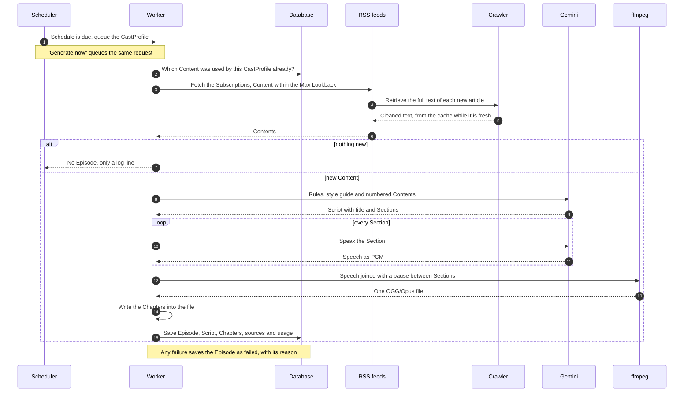
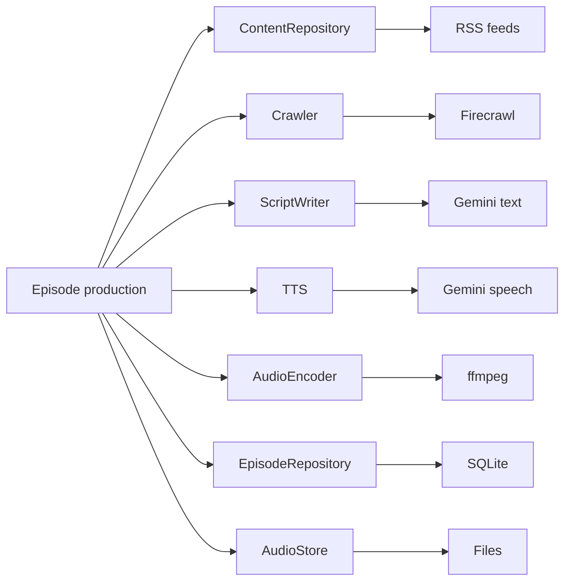

# AI Gude

*Ei Gude* is Hessian for good morning, and AI Gude sounds just like it. It is your own morning podcast.

You choose the news sources you follow and how the show should sound. At the times you pick, AI Gude reads what is new,
writes a script in your style, speaks it with an AI voice and delivers one audio Episode with chapters, made for
listening on your phone.

You host it yourself. AI Gude is free and open source software.

**Live demo:** [aigude.alexdoes.dev](https://aigude.alexdoes.dev). Sign in with the user `demo` and the password `demo`.
You can browse the Episodes and play them. You cannot switch users, produce, retry or delete Episodes, and the log, the editor of the User Config and the problems of its files stay closed.

## Table of Contents

- [Getting Started](#getting-started)
- [Concepts](#concepts)
  - [How AI Gude works](#how-ai-gude-works)
  - [Operating modes](#operating-modes)
- [How-Tos](#how-tos)
- [License](#license)

## Getting Started

In this tutorial you start AI Gude on your machine and listen to your first Episode.

1. Clone the repository.

   ```bash
   git clone https://github.com/alex0ptr/aigude.git
   cd aigude
   ```

2. Install the tools with [mise](https://mise.jdx.dev), which has to be
   [activated in your shell](https://mise.jdx.dev/getting-started.html). It installs the versions of Go, ffmpeg and
   task that the project pins.

   ```bash
   mise install
   ```

3. Get a key at [Google AI Studio](https://aistudio.google.com/apikey) for the language model and the voice, and one
   at [Firecrawl](https://www.firecrawl.dev) for reading the articles. Export both.

   ```bash
   export GEMINI_API_KEY="..."
   export FIRECRAWL_API_KEY="..."
   ```

4. Start the service with the example configuration in `hack/`.

   ```bash
   task serve:hosted
   ```

   It can be reached from your network, so run it on a network you trust.

5. Open <http://localhost:8080>, choose the show and press "Generate now". Producing the Episode takes a few minutes.
   When it is done it appears in the list. Press play.

You have a running AI Gude. To follow your own feeds, continue with [Configure Shows, Feeds and Schedules](#configure-shows-feeds-and-schedules).

## Concepts

### How AI Gude works

A User owns CastProfiles, and each CastProfile is a show. A CastProfile lists the Subscriptions it draws Content from,
which are RSS feeds, a Max Lookback that says how old Content may be, and Schedules that say when an Episode is made.
Content is one item that a Subscription delivers, such as an article. An Episode is one audio file with its Script and
its Chapters, one Chapter for each Section of the Script.

The core flow, from a Schedule to a finished Episode:



What to keep in mind:

- One Episode is produced at a time. Requests wait in a queue.
- Choose a Max Lookback that is larger than the interval between two Schedules. Content older than the Max Lookback is
  never considered, so a shorter one lets articles fall through the gap between two Episodes.
- A larger Max Lookback does no harm, because each Episode remembers the Content it used and no article is told twice.
  Deleting an Episode gives its Content back.
- A Schedule that was due while the service was not running is made up at the start, once for each CastProfile.
- A failed Episode stays in the list with its reason. You can try again or dismiss it.
- Each Section is spoken in its own call, which makes the Chapters exact, and the audio is encoded once at the end.

Behind the steps are small interfaces, and one adapter each does the work today:



### Operating modes

The only part you can run in two ways is the Crawler, which retrieves the full text of the articles. You choose it with
the setting `firecrawl_url`.

- The hosted Firecrawl is the default and needs `FIRECRAWL_API_KEY`. There is nothing to run, and it bills per page.
  The Getting Started uses it.
- A Firecrawl of your own costs nothing per page. Set `firecrawl_url` to its address. The key is then optional and is
  sent only when it is set. `task serve` starts one in Docker from [hack/firecrawl/](hack/firecrawl/README.md), but
  that one is for development only and has no authentication, so it is not a recipe for hosting.

AI Gude keeps crawled pages for `crawl_cache_ttl`, which is ten days by default, and shares them between all Users. An
article that is retrieved again soon costs nothing.

## How-Tos

### Configure the Service Settings

Settings apply to the whole service. The commented example is [hack/aigude.toml](hack/aigude.toml).

- Settings come from built-in defaults, the settings file, environment variables and flags, and each one overrides the
  one before it. An environment variable is `AIGUDE_` plus the upper-case key, for example `AIGUDE_LISTEN_ADDR`. A flag
  is the key with hyphens, for example `--listen-addr`.
- The settings file is `aigude.toml` in the working directory of the service, or the file given with `--config`. It is
  optional. The example lists every setting with its default and a comment, and a test guards that the defaults it
  shows are the real ones. Copy it and delete what you do not want to change.
- A key the service does not know is an error, and so is an invalid value. The message names the setting. Changes need
  a restart.
- The API keys `GEMINI_API_KEY` and `FIRECRAWL_API_KEY` are not settings. A key in the settings file is rejected as an
  unknown key and the service does not start, so they come from the environment only.

### Configure Shows, Feeds and Schedules

Shows, feeds and Schedules belong to a User and live in that User's file. The commented example is
[hack/users/demo.toml](hack/users/demo.toml), and it is the template for new Users.

- Each User has one `.toml` file in the folder `users_dir`, which is `users` by default. The file name is free, and the
  User is identified by the Id inside.
- A file holds the User, its CastProfiles, and for each CastProfile the Subscriptions, Max Lookback, language, voice,
  prompt and Schedules.
- The files are followed while the service runs, so an edit takes effect without a restart. A file that turns invalid
  keeps the last valid setup of its User, and the interface shows the problem. A deleted file takes its User away.
- A User can edit their own file in the interface with "Edit User Config". To check files without starting anything
  run this:

```bash
aigude validate --users-dir users
```

### Configure Multiple Users and Authentication

AI Gude has no sign-in of its own. Authentication is the job of a reverse proxy in front of it. The proxy tells AI Gude
who is asking in a request header, and from then on each person works in their own User and cannot reach another one.

#### Start without authentication

Without the header everyone who reaches the port can switch between all Users in the interface, produce and delete
Episodes and edit every User Config. At home on a network you trust that is a fine way to share one instance. It is
also why the service listens on `127.0.0.1` by default. Do not leave it like this on a network that others can reach.

To add a User, copy [hack/users/demo.toml](hack/users/demo.toml) into the users folder and change the `[user]` table
and what follows. The file is picked up at once.

#### Pin each person to their User

After the proxy has authenticated a person, it sets the header `X-Aigude-User` to the Id of their User. Use the Id and
not the display name, because only the Id never changes.

A request with this header belongs to that User. The interface offers no switch to another User, a request to switch
is refused, and the person sees only their own Episodes and edits only their own User Config. A header that is empty,
that names no User or that names a User without a valid setup is answered with 403 for every request.

Two things have to hold for this to be safe:

- The port is reachable only through the proxy.
- The proxy sets the header itself on every request and never passes one on from the client. A request without the
  header gets full rights, so a proxy that forgets it opens the service to everyone.

#### Example with Traefik and Basic Auth

Traefik asks for a user name and a password and writes the name into `X-Aigude-User`. So the user name of the Basic Auth
is the Id of the User. Create the users file with one line for each person, for example with `htpasswd`:

```bash
htpasswd -nB alex >> /etc/traefik/users
```

Then add the route and its middleware to the dynamic configuration of Traefik. Replace the host name and the address of
the service. The example assumes an entry point `websecure` and a certificate resolver `letsencrypt`. Serve it over
HTTPS, because Basic Auth sends the password with every request.

```yaml
http:
  routers:
    aigude:
      rule: Host(`aigude.example.org`)
      entryPoints:
        - websecure
      service: aigude
      middlewares:
        - aigude-auth
      tls:
        certResolver: letsencrypt

  middlewares:
    aigude-auth:
      basicAuth:
        usersFile: /etc/traefik/users
        realm: AI Gude
        headerField: X-Aigude-User
        removeHeader: true

  services:
    aigude:
      loadBalancer:
        servers:
          - url: http://127.0.0.1:8080
```

`headerField` makes Traefik set `X-Aigude-User` from the user name and replaces a value that the client sent, and
`removeHeader` keeps the credentials from reaching AI Gude. A name in the users file that is not a User of AI Gude is
answered with 403.

#### Show the demo User to visitors

The User with the Id `demo` is shown in Demo Mode. Whoever looks at its pages can browse and play its Episodes, and
nothing can be changed. The log and the editor of the User Config are closed, and the interface leaves out what only the
person running the service should see, such as problems in the User Config files. Because "Generate now" is closed too,
the Episodes of the demo User come from its Schedules. Create it like any User, for example from the sample
[hack/users/demo.toml](hack/users/demo.toml) with the Id `demo`.

### Run and Maintain the Service

- Produce an Episode with "Generate now" on a CastProfile, or let its Schedules do it.
- Episodes are deleted with their audio once they are older than the Retention, the time Episodes are kept. The setting is `episode_retention`, it
  is 30 days by default, it counts from the creation of the Episode and it applies to failed Episodes too. `0` keeps
  them for ever. The check runs at the start and once a day, and a deleted Episode gives its Content back.
- The meter on an Episode shows what it consumed, such as tokens and crawled pages.
- `GET /healthz` answers `200` with `ok` and checks nothing behind it, not the database, not Gemini and not Firecrawl.
  It needs no headers of a proxy.
- Back up the data folder `data_dir`. It holds the SQLite database and the audio files. The User Config files are the
  only copy of your configuration.

### Install AI Gude on a Linux VM

> **The whole Ansible part is vibe coded.** An AI assistant wrote the collection. The roles were run on a host and
> worked, but nobody has reviewed the code. Be especially careful. Read the roles before you run them, try them with
> `ansible-playbook --check` first, and use a host that you can set up again. The only automatic check is
> `ansible-lint`.

The Ansible collection [alex0ptr.aigude](deploy/ansible_collections/alex0ptr/aigude/README.md) installs AI Gude on a
Linux host with rootful Podman, as systemd quadlets. It can also install Traefik with HTTPS and a sign-in in front of it,
and a Firecrawl of your own. The host needs Ubuntu 24.04, Debian 13 or another system with Podman 4.8 or newer.

1. Add the collection to the `requirements.yml` of your Ansible project and install it:

   ```yaml
   collections:
     - name: https://github.com/alex0ptr/aigude.git#/deploy/ansible_collections/alex0ptr/aigude
       type: git
       version: main
   ```

   ```bash
   ansible-galaxy collection install -r requirements.yml
   ```

2. Copy the example playbook that fits from
   [deploy/ansible_collections/alex0ptr/aigude/playbooks/](deploy/ansible_collections/alex0ptr/aigude/playbooks/). There
   is one for each combination of no proxy or Traefik, and the hosted Firecrawl or one of your own.
3. Set your host group and your values in it. The Gemini key and the address of the Firecrawl are the least it needs.
4. Run it with `ansible-playbook`.

Without a proxy AI Gude then listens on `127.0.0.1:8080` of the host. The README of the collection lists the variables
and says what to know about the image, the networks and the firewall.

## License

AI Gude is licensed under the GNU Affero General Public License, version 3 or later. See [LICENSE](LICENSE).

Copyright © 2025 to 2026 Alex Krause.
